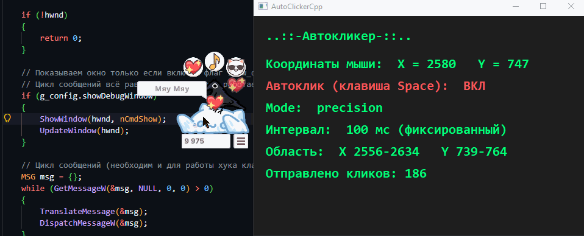

# AutoClickerCpp

**English** | [Русский](README.md)

A simple auto-clicker in C++/WinAPI. Simulates left mouse button clicks.

- The **Space** key toggles auto-click (global `WH_KEYBOARD_LL` hook).
- Cursor coordinates and state are shown in a window (can be disabled via `show_debug_window`).



## Build

```powershell
g++ main.cpp -o AutoClickerCpp.exe -mwindows -municode -static -luser32 -lgdi32
```

or via CMake:

```powershell
cmake -S . -B build
cmake --build build --config Release
```

> Requires MinGW-w64 (supports `-municode`), not the old MinGW.org.

## Configuration (`config.ini`)

The file must be next to the exe. Format — `key = value`, comments start with `;` or `#`.

| Key | Description |
| --- | --- |
| `mode` | `fixed` / `random` / `precision` |
| `fixed_interval` | Fixed interval between clicks, ms (`fixed`, `precision`) |
| `interval_min` / `interval_max` | Random interval range, ms (`random`) |
| `down_delay_min` / `down_delay_max` | Random delay between press and release, ms |
| `precision_min_x` / `precision_min_y` / `precision_max_x` / `precision_max_y` | Rectangular click area (`precision`) |
| `show_debug_window` | `true`/`false` — show the application window (default `true`) |

### Modes

- **fixed** — fixed interval (`fixed_interval`), click at the current cursor position.
- **random** — random interval in the range `[interval_min, interval_max]`.
- **precision** — click at a random point inside the rectangle
  `[precision_min_x, precision_min_y]` … `[precision_max_x, precision_max_y]`,
  interval — `fixed_interval`.

### show_debug_window

If `show_debug_window = false`, the window is not shown, but the auto-clicker keeps
running in the background (toggled with the Space key). Use Task Manager to quit.
