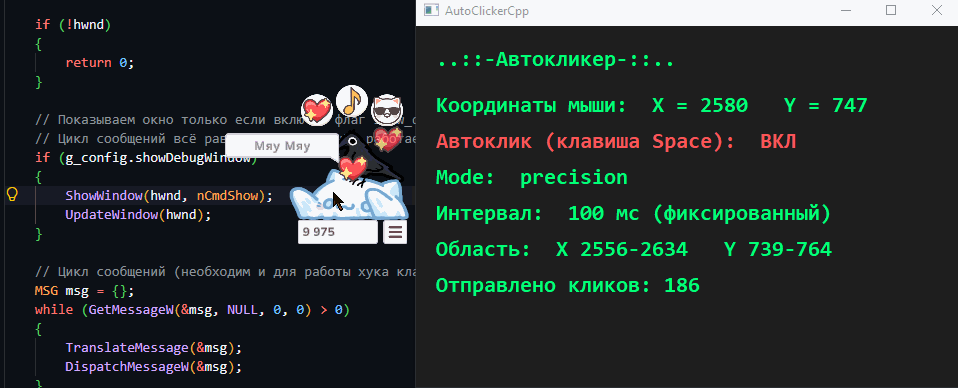

# AutoClickerCpp

Простой автокликер на C++/WinAPI. Имитирует клики левой кнопкой мыши.

- Клавиша **Space** включает/выключает автоклик (глобальный хук `WH_KEYBOARD_LL`).
- Координаты курсора и состояние выводятся в окне (можно отключить через `show_debug_window`).



## Сборка

```powershell
g++ main.cpp -o AutoClickerCpp.exe -mwindows -municode -static -luser32 -lgdi32
```

или через CMake:

```powershell
cmake -S . -B build
cmake --build build --config Release
```

> Требуется MinGW-w64 (поддержка `-municode`), а не старый MinGW.org.

## Конфигурация (`config.ini`)

Файл должен лежать рядом с exe. Формат — `ключ = значение`, комментарии через `;` или `#`.

| Ключ | Описание |
| --- | --- |
| `mode` | `fixed` / `random` / `precision` |
| `fixed_interval` | Фиксированный интервал между кликами, мс (`fixed`, `precision`) |
| `interval_min` / `interval_max` | Диапазон случайного интервала, мс (`random`) |
| `down_delay_min` / `down_delay_max` | Случайная задержка между нажатием и отпусканием, мс |
| `precision_min_x` / `precision_min_y` / `precision_max_x` / `precision_max_y` | Прямоугольная область кликов (`precision`) |
| `show_debug_window` | `true`/`false` — показывать окно приложения (по умолчанию `true`) |

### Режимы

- **fixed** — фиксированный интервал (`fixed_interval`), клик в текущей позиции курсора.
- **random** — случайный интервал в диапазоне `[interval_min, interval_max]`.
- **precision** — клик в случайной точке внутри прямоугольника
  `[precision_min_x, precision_min_y]` … `[precision_max_x, precision_max_y]`,
  интервал — `fixed_interval`.

### show_debug_window

Если `show_debug_window = false`, окно не показывается, но автокликер продолжает
работать в фоне (управление клавишей Space). Для завершения используйте диспетчер задач.
